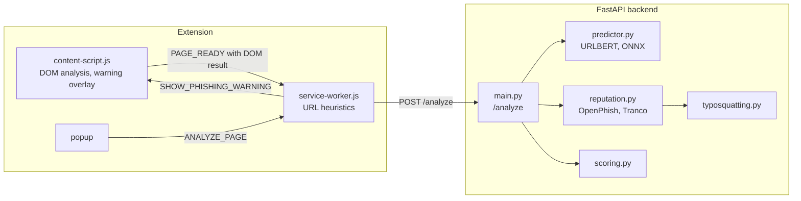

# Phishing Risk Detector

A Chrome extension that estimates how likely a web page is to be a
phishing page. It combines five independent signals into one risk
score from 0 to 100:

| Signal | Where | What it checks |
|---|---|---|
| URL heuristics | extension | HTTPS, IP address as host, URL length, number of subdomains, words like `login` or `verify` |
| DOM analysis | extension | password fields, forms that submit to another origin, texts like "verify your account" |
| Machine learning | backend | URLBERT model trained on 1.7M URLs from two datasets, returns a phishing probability |
| Reputation | backend | exact match in the OpenPhish feed, presence in the Tranco top 1M list |
| Typosquatting | backend | domains that imitate popular domains (`rnicrosoft.com`, `amazom.com`, `paypal-login.com`, `paypal.com.account-check.xyz`) |

## Architecture



1. When a page is ready, the content script analyzes its DOM and sends
   the result with the URL to the service worker, which sends everything
   to the backend in one request. If the backend returns `block: true`,
   the content script shows a full-page warning with the option to go
   back or continue.
2. When the user opens the popup, it shows the result of that same
   analysis. The DOM is checked again first; only if it changed since the
   page loaded (for example a login form appeared later) is the page
   analyzed again.

### Scoring

All scoring rules are in [`backend/app/scoring.py`](backend/app/scoring.py).
The URL, ML and DOM scores are uncertain signals, so they are combined
with the same weights for every page:

```
weighted score = 0.35 · URL + 0.45 · ML + 0.20 · DOM
```

The reputation result is not part of that sum. A match in a list is
treated as a fact, so it sets a minimum or a maximum for the score:

| Reputation status | Rule |
|---|---|
| malicious (URL in OpenPhish) | score = max(weighted score, 85), always blocked |
| suspicious (typosquatting) | score = max(weighted score, 50) |
| popular (Tranco top 1M) | score = min(weighted score, 20), unless the URL or DOM score is 40 or more |
| unknown | score = weighted score |

When three or more signals are strong at the same time, the score is at
least 70. Scores of 70 and above are classified as *Likely phishing*,
40 to 69 as *Suspicious*, and below 40 as *Likely safe*.

## Project structure

```
backend/                  API server
  app/
    main.py               /analyze and /health endpoints
    scoring.py            combination of the scores
    predictor.py          URL model (ONNX Runtime)
    reputation.py         OpenPhish and Tranco lookups
    typosquatting.py      look-alike domain detection
  data/                   OpenPhish, Tranco and public suffix lists
  models/urlbert_combined_v2/   URL model exported to ONNX
  scripts/download_reputation_data.py
  tests/
extension/                Chrome extension (Manifest V3)
  icons/
research/                 training and evaluation of the URL model
  notebooks/              training notebooks (Google Colab)
  models/                 trained models (PyTorch)
  results/                evaluation metrics (JSON)
  evaluate_*.py, export_onnx.py
demo/                     offline phishing demo page
```

The research part has its own [README](research/README.md).

## Setup

Requires Python 3.13 or newer and Google Chrome.

```bash
cd backend
python -m venv .venv
.venv/Scripts/activate        # Windows, on Linux/macOS: source .venv/bin/activate
pip install -r requirements.txt
```

Download the current OpenPhish feed, Tranco list and public suffix list
(optional, the repository contains a copy):

```bash
python scripts/download_reputation_data.py
```

Start the backend:

```bash
uvicorn app.main:app --host 127.0.0.1 --port 8000
```

Load the extension:

1. Open `chrome://extensions` and enable *Developer mode*.
2. Click *Load unpacked* and select the `extension` folder.

The extension expects the backend at `http://127.0.0.1:8000`.

### Demo

[`demo/secure-login/verify-account.html`](demo/secure-login/verify-account.html)
is a fake login page of a made-up bank for showing the extension without
opening real phishing sites. Its form never sends data. The extension
ignores `localhost` and `127.0.0.1`, so the page is served on `127.0.0.2`,
which is also the local computer:

```bash
python -m http.server 8080 --bind 127.0.0.2 --directory demo
```

With the backend running, open
`http://127.0.0.2:8080/secure-login/verify-account.html`. The warning page
appears after loading, and the popup shows a score of 77 (*Likely
phishing*) with all URL, ML and DOM indicators.

### Tests

```bash
cd backend
pytest
```

## Machine learning model

The backend uses `urlbert_combined_v2`, a small BERT model for URLs
(8 layers, 64 tokens, about 4M parameters). It was trained from
[`CrabInHoney/urlbert-tiny-base-v4`](https://huggingface.co/CrabInHoney/urlbert-tiny-base-v4),
which is pre-trained on URLs without phishing labels, for two epochs on
1,708,272 URLs from two datasets:

- vonpower (`vonDataset20180426.dill`), official training split
- [`ealvaradob/phishing-dataset`](https://huggingface.co/datasets/ealvaradob/phishing-dataset),
  80% of the URLs (the split is selected by a hash of the URL)

The URL scheme (`http://`, `https://`) is removed before training and
before every prediction (`preprocessing.json` in the model directory), so
the model cannot use it. URLs from both test sets are excluded from the
training data. Training took 21 minutes on a free Google Colab T4 GPU and
is documented in
[`research/notebooks/train_urlbert_combined.ipynb`](research/notebooks/train_urlbert_combined.ipynb).

The model accepts at most 64 tokens. Longer URLs are split into
overlapping chunks and the logits of all chunks are averaged, both
during training and in [`predictor.py`](backend/app/predictor.py).

The model is trained with PyTorch and exported to ONNX
([`research/export_onnx.py`](research/export_onnx.py)). The backend runs it
with ONNX Runtime, which gives the same predictions (largest difference
of the logits about 10⁻⁶) but needs much less memory: the whole backend
uses about 260 MB instead of almost 900 MB with PyTorch.

### Previous model

The first model, `urlbert_vonpower_full`, was the phishing classifier
[`CrabInHoney/urlbert-tiny-v4-phishing-classifier`](https://huggingface.co/CrabInHoney/urlbert-tiny-v4-phishing-classifier)
fine-tuned for one epoch on vonpower only
([`train_urlbert_vonpower.ipynb`](research/notebooks/train_urlbert_vonpower.ipynb)).
Its evaluation showed two problems that the second model addresses:

1. In vonpower 97% of the phishing URLs use `http://`, and the model
   learned that `http://` means phishing. When the phishing test URLs were
   rewritten to `https://`, the share it detected dropped from 98.6% to
   90.9%. Most phishing pages today use HTTPS.
2. On the independent ealvaradob dataset it reached only an F1 of 0.82
   with a recall of 74%, compared to 0.99 on its own test split.

### Evaluation

The evaluation scripts need the packages from `research/requirements.txt`
and the datasets in `research/data/` (not part of the repository). They
are run from the repository root; see the [research README](research/README.md).

```bash
pip install -r research/requirements.txt
python -m research.download_ealvaradob_dataset
python -m research.evaluate_urlbert_vonpower
python -m research.evaluate_urlbert_ealvaradob
python -m research.evaluate_urlbert_vonpower --model-dir research/models/urlbert_vonpower_full
python -m research.evaluate_urlbert_ealvaradob --model-dir research/models/urlbert_vonpower_full
python -m research.evaluate_pipeline
```

All results are for threshold 0.5. Both test sets were never used for
training the current model.

**vonpower test split** (155,937 URLs):

| Model | ROC-AUC | Precision | Recall | F1 | False positive rate |
|---|---|---|---|---|---|
| Original classifier (no fine-tuning) | 0.9713 | 0.815 | 0.968 | 0.885 | 20.7% |
| `urlbert_vonpower_full` (previous) | 0.9991 | 0.992 | 0.984 | 0.988 | 0.8% |
| **`urlbert_combined_v2` (current)** | 0.9985 | 0.991 | 0.970 | 0.981 | 0.8% |

**ealvaradob test split** (76,304 URLs, every URL rewritten to `https://`,
because most legitimate URLs in this dataset have no scheme):

| Model | ROC-AUC | Precision | Recall | F1 | False positive rate |
|---|---|---|---|---|---|
| Original classifier* | 0.9873 | 0.878 | 0.960 | 0.917 | 10.1% |
| `urlbert_vonpower_full` (previous) | 0.9555 | 0.918 | 0.740 | 0.820 | 5.0% |
| **`urlbert_combined_v2` (current)** | 0.9962 | 0.963 | 0.975 | 0.969 | 2.8% |

\* The original classifier was trained on the whole ealvaradob dataset,
including this test split, so its result is not an independent evaluation.

With `http://` instead of `https://`, the previous model's false positive
rate rises from 5.0% to 21.1%, while the current model gives exactly the
same predictions for both schemes.

**Complete pipeline.** [`evaluate_pipeline.py`](research/evaluate_pipeline.py)
runs every test URL through the whole backend: URL heuristics (a Python
port of the extension code), ML model, reputation lists, typosquatting
and `scoring.py`. The DOM score is 0 because the datasets contain no page
content, so the numbers show what the system detects from the address
alone; on a real page, suspicious content raises the score further.
Share of URLs classified as *Suspicious* or *Likely phishing*:

| Dataset | Model | Phishing detected | Legitimate flagged |
|---|---|---|---|
| vonpower | previous | 89.0% | 0.09% |
| vonpower | current | 86.9% | 0.08% |
| ealvaradob | previous | 51.5% | 1.32% |
| ealvaradob | current | 85.2% | 0.68% |

### Limitations

- In both datasets the legitimate URLs are mostly content pages. Login
  pages of legitimate sites therefore get high ML scores (Gmail 81%, the
  FINKI courses login 96%). For domains in the Tranco list this has no
  effect, because their score is limited to 20, but a login page of a
  small legitimate site that is in no list is classified as *Suspicious*.
- Without suspicious page content the score of an unknown domain can
  hardly reach 70, so a phishing page whose content looks harmless is
  usually *Suspicious* rather than *Likely phishing*. The warning is
  shown only for pages that match the blocking rules in `scoring.py`.
- The vonpower dataset is from 2018, newer phishing techniques are only
  represented by the ealvaradob data.
- The URL and DOM heuristics are computed in the extension and sent to
  the backend, so their scores are not verified by the backend.
- The reputation data is a local snapshot and has to be refreshed with
  `scripts/download_reputation_data.py`.

## Data sources

- [OpenPhish](https://openphish.com/) public feed of phishing URLs
- [Tranco](https://tranco-list.eu/) list of the top 1 million domains
- vonpower dataset `vonDataset20180426.dill` (training and test data)
- [`ealvaradob/phishing-dataset`](https://huggingface.co/datasets/ealvaradob/phishing-dataset) (training and independent evaluation)
