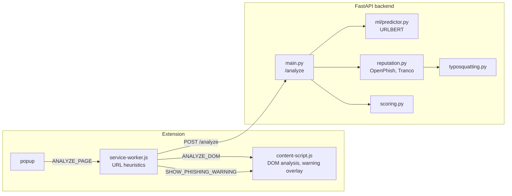

# Phishing Risk Detector

A Chrome extension that estimates how likely a web page is to be a
phishing page. It combines five independent signals into one risk
score from 0 to 100:

| Signal | Where | What it checks |
|---|---|---|
| URL heuristics | extension | HTTPS, IP address as host, URL length, number of subdomains, words like `login` or `verify` |
| DOM analysis | extension | password fields, forms that submit to another origin, texts like "verify your account" |
| Machine learning | backend | URLBERT model trained on 1.7M URLs from two datasets, returns a phishing probability |
| Reputation | backend | exact match in the OpenPhish feed, presence in the Tranco top 1M list |
| Typosquatting | backend | domains that imitate popular domains (`rnicrosoft.com`, `amazom.com`, `paypal-login.com`, `paypal.com.account-check.xyz`) |

## Architecture



1. When a page finishes loading, the service worker sends its URL to the
   backend. If the backend returns `block: true`, the content script
   shows a full-page warning with the option to go back or continue.
2. When the user opens the popup, the DOM is analyzed as well and the
   full result with all indicators is shown.

### Scoring

All scoring rules are in [`backend/app/scoring.py`](backend/app/scoring.py).
The weights depend on the reputation status, because a phishing feed
match or a popular domain is stronger evidence than the other signals:

| Reputation status | URL | ML | DOM | Reputation | Additional rule |
|---|---|---|---|---|---|
| malicious (in OpenPhish) | 0.25 | 0.35 | 0.15 | 0.25 | at least 85 |
| suspicious (typosquatting) | 0.20 | 0.25 | 0.10 | 0.45 | at least 50 |
| popular (Tranco top 1M) | 0.25 | 0.10 | 0.15 | 0.50 | at most 20 unless URL or DOM score is 40 or more |
| unknown | 0.35 | 0.45 | 0.20 | 0 | |

When three or more signals are strong at the same time, the score is at
least 70. Scores of 70 and above are classified as *Likely phishing*,
40 to 69 as *Suspicious*, and below 40 as *Likely safe*.

## Project structure

```
backend/
  app/                    runtime code of the API
    main.py               /analyze and /health endpoints
    scoring.py            combination of the scores
    reputation.py         OpenPhish and Tranco lookups
    typosquatting.py      look-alike domain detection
    reputation_downloader.py
    reputation_data/      downloaded OpenPhish and Tranco lists
    ml/predictor.py       URLBERT inference
    ml/models/urlbert_combined_v2/     current URL model
    ml/models/urlbert_vonpower_full/   previous URL model (for comparison)
  ml/                     training, evaluation and dataset scripts
    train_urlbert_vonpower.ipynb       fine-tuning notebook (Google Colab)
    train_urlbert_combined.ipynb       second model: vonpower + ealvaradob, no scheme
    evaluate_urlbert_vonpower.py       evaluation on the held-out test split
    evaluate_urlbert_ealvaradob.py     evaluation on an independent dataset
    evaluate_pipeline.py               evaluation of the complete scoring pipeline
    results/              evaluation metrics (JSON)
  tests/
extension/                Chrome extension (Manifest V3)
```

## Setup

Requires Python 3.10 or newer (developed with 3.14) and Google Chrome.

```bash
cd backend
python -m venv .venv
.venv/Scripts/activate        # Windows, on Linux/macOS: source .venv/bin/activate
pip install -r requirements.txt
```

Download the current OpenPhish feed and Tranco list (optional, the
repository already contains a copy):

```bash
python -m app.reputation_downloader
```

Start the backend:

```bash
uvicorn app.main:app --host 127.0.0.1 --port 8000
```

Load the extension:

1. Open `chrome://extensions` and enable *Developer mode*.
2. Click *Load unpacked* and select the `extension` folder.

The extension expects the backend at `http://127.0.0.1:8000`.

### Tests

```bash
cd backend
pytest
```

## Machine learning model

The backend uses `urlbert_combined_v2`, a small BERT model for URLs
(8 layers, 64 tokens, about 4M parameters). It was trained from
[`CrabInHoney/urlbert-tiny-base-v4`](https://huggingface.co/CrabInHoney/urlbert-tiny-base-v4),
which is pre-trained on URLs without phishing labels, for two epochs on
1,708,272 URLs from two datasets:

- vonpower (`vonDataset20180426.dill`), official training split
- [`ealvaradob/phishing-dataset`](https://huggingface.co/datasets/ealvaradob/phishing-dataset),
  80% of the URLs (the split is selected by a hash of the URL)

The URL scheme (`http://`, `https://`) is removed before training and
before every prediction (`preprocessing.json` in the model directory), so
the model cannot use it. URLs from both test sets are excluded from the
training data. Training took 21 minutes on a free Google Colab T4 GPU and
is documented in
[`backend/ml/train_urlbert_combined.ipynb`](backend/ml/train_urlbert_combined.ipynb).

The model accepts at most 64 tokens. Longer URLs are split into
overlapping chunks and the logits of all chunks are averaged, both
during training and in [`predictor.py`](backend/app/ml/predictor.py).

### Previous model

The first model, `urlbert_vonpower_full`, was the phishing classifier
[`CrabInHoney/urlbert-tiny-v4-phishing-classifier`](https://huggingface.co/CrabInHoney/urlbert-tiny-v4-phishing-classifier)
fine-tuned for one epoch on vonpower only
([`train_urlbert_vonpower.ipynb`](backend/ml/train_urlbert_vonpower.ipynb)).
Its evaluation showed two problems that the second model addresses:

1. In vonpower 97% of the phishing URLs use `http://`, and the model
   learned that `http://` means phishing. When the phishing test URLs were
   rewritten to `https://`, the share it detected dropped from 98.6% to
   90.9%. Most phishing pages today use HTTPS.
2. On the independent ealvaradob dataset it reached only an F1 of 0.82
   with a recall of 74%, compared to 0.99 on its own test split.

### Evaluation

The evaluation scripts need the additional packages from
`requirements-ml.txt` and the datasets in `backend/app/ml/data/`
(not part of the repository).

```bash
pip install -r requirements-ml.txt
python -m ml.download_ealvaradob_dataset
python -m ml.evaluate_urlbert_vonpower --model-dir app/ml/models/urlbert_combined_v2
python -m ml.evaluate_urlbert_ealvaradob --model-dir app/ml/models/urlbert_combined_v2
python -m ml.evaluate_urlbert_vonpower --model-dir app/ml/models/urlbert_vonpower_full
python -m ml.evaluate_urlbert_ealvaradob --model-dir app/ml/models/urlbert_vonpower_full
python -m ml.evaluate_pipeline
```

All results are for threshold 0.5. Both test sets were never used for
training the current model.

**vonpower test split** (155,937 URLs):

| Model | ROC-AUC | Precision | Recall | F1 | False positive rate |
|---|---|---|---|---|---|
| Original classifier (no fine-tuning) | 0.9713 | 0.815 | 0.968 | 0.885 | 20.7% |
| `urlbert_vonpower_full` (previous) | 0.9991 | 0.992 | 0.984 | 0.988 | 0.8% |
| **`urlbert_combined_v2` (current)** | 0.9985 | 0.991 | 0.970 | 0.981 | 0.8% |

**ealvaradob test split** (76,304 URLs, every URL rewritten to `https://`,
because most legitimate URLs in this dataset have no scheme):

| Model | ROC-AUC | Precision | Recall | F1 | False positive rate |
|---|---|---|---|---|---|
| Original classifier* | 0.9873 | 0.878 | 0.960 | 0.917 | 10.1% |
| `urlbert_vonpower_full` (previous) | 0.9555 | 0.918 | 0.740 | 0.820 | 5.0% |
| **`urlbert_combined_v2` (current)** | 0.9962 | 0.963 | 0.975 | 0.969 | 2.8% |

\* The original classifier was trained on the whole ealvaradob dataset,
including this test split, so its result is not an independent evaluation.

With `http://` instead of `https://`, the previous model's false positive
rate rises from 5.0% to 21.1%, while the current model gives exactly the
same predictions for both schemes.

**Complete pipeline.** [`evaluate_pipeline.py`](backend/ml/evaluate_pipeline.py)
runs every test URL through the whole backend: URL heuristics (a Python
port of the extension code), ML model, reputation lists, typosquatting
and `scoring.py`. The DOM score is 0 because the datasets contain no page
content; this is also the situation of the automatic check when a page
is opened. Share of URLs classified as *Suspicious* or *Likely phishing*:

| Dataset | Model | Phishing detected | Legitimate flagged |
|---|---|---|---|
| vonpower | previous | 88.8% | 0.09% |
| vonpower | current | 86.8% | 0.08% |
| ealvaradob | previous | 51.5% | 1.32% |
| ealvaradob | current | 85.2% | 0.68% |

### Limitations

- In both datasets the legitimate URLs are mostly content pages. Login
  pages of legitimate sites therefore get high ML scores (Gmail 81%, the
  FINKI courses login 96%). For domains in the Tranco list this has no
  effect, because their score is limited to 20, but a login page of a
  small legitimate site that is in no list is classified as *Suspicious*.
- Without DOM data the score of an unknown domain can hardly reach 70, so
  most phishing pages are *Suspicious* rather than *Likely phishing*. The
  automatic warning is shown only for pages that match the blocking rules
  in `scoring.py`.
- The vonpower dataset is from 2018, newer phishing techniques are only
  represented by the ealvaradob data.
- The URL and DOM heuristics are computed in the extension and sent to
  the backend, so their scores are not verified by the backend.
- The reputation data is a local snapshot and has to be refreshed with
  `reputation_downloader.py`.

## Data sources

- [OpenPhish](https://openphish.com/) public feed of phishing URLs
- [Tranco](https://tranco-list.eu/) list of the top 1 million domains
- vonpower dataset `vonDataset20180426.dill` (training and test data)
- [`ealvaradob/phishing-dataset`](https://huggingface.co/datasets/ealvaradob/phishing-dataset) (training and independent evaluation)
