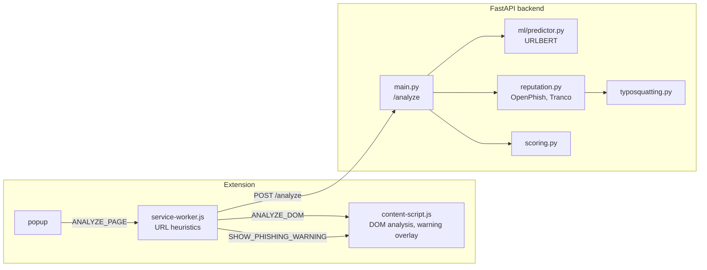

# Phishing Risk Detector

A Chrome extension that estimates how likely a web page is to be a
phishing page. It combines five independent signals into one risk
score from 0 to 100:

| Signal | Where | What it checks |
|---|---|---|
| URL heuristics | extension | HTTPS, IP address as host, URL length, number of subdomains, words like `login` or `verify` |
| DOM analysis | extension | password fields, forms that submit to another origin, texts like "verify your account" |
| Machine learning | backend | URLBERT model fine-tuned on 1.25M URLs, returns a phishing probability |
| Reputation | backend | exact match in the OpenPhish feed, presence in the Tranco top 1M list |
| Typosquatting | backend | domains that imitate popular domains (`rnicrosoft.com`, `amazom.com`, `paypal-login.com`, `paypal.com.account-check.xyz`) |

## Architecture



1. When a page finishes loading, the service worker sends its URL to the
   backend. If the backend returns `block: true`, the content script
   shows a full-page warning with the option to go back or continue.
2. When the user opens the popup, the DOM is analyzed as well and the
   full result with all indicators is shown.

### Scoring

All scoring rules are in [`backend/app/scoring.py`](backend/app/scoring.py).
The weights depend on the reputation status, because a phishing feed
match or a popular domain is stronger evidence than the other signals:

| Reputation status | URL | ML | DOM | Reputation | Additional rule |
|---|---|---|---|---|---|
| malicious (in OpenPhish) | 0.25 | 0.35 | 0.15 | 0.25 | at least 85 |
| suspicious (typosquatting) | 0.20 | 0.25 | 0.10 | 0.45 | at least 50 |
| popular (Tranco top 1M) | 0.25 | 0.10 | 0.15 | 0.50 | at most 20 unless URL or DOM score is 40 or more |
| unknown | 0.35 | 0.45 | 0.20 | 0 | |

When three or more signals are strong at the same time, the score is at
least 70. Scores of 70 and above are classified as *Likely phishing*,
40 to 69 as *Suspicious*, and below 40 as *Likely safe*.

## Project structure

```
backend/
  app/                    runtime code of the API
    main.py               /analyze and /health endpoints
    scoring.py            combination of the scores
    reputation.py         OpenPhish and Tranco lookups
    typosquatting.py      look-alike domain detection
    reputation_downloader.py
    reputation_data/      downloaded OpenPhish and Tranco lists
    ml/predictor.py       URLBERT inference
    ml/models/urlbert_vonpower_full/   fine-tuned model
  ml/                     training, evaluation and dataset scripts
    train_urlbert_vonpower.ipynb       fine-tuning notebook (Google Colab)
    evaluate_urlbert_vonpower.py       evaluation on the held-out test split
    evaluate_urlbert_ealvaradob.py     evaluation on an independent dataset
    results/              evaluation metrics (JSON)
  tests/
extension/                Chrome extension (Manifest V3)
```

## Setup

Requires Python 3.10 or newer (developed with 3.14) and Google Chrome.

```bash
cd backend
python -m venv .venv
.venv/Scripts/activate        # Windows, on Linux/macOS: source .venv/bin/activate
pip install -r requirements.txt
```

Download the current OpenPhish feed and Tranco list (optional, the
repository already contains a copy):

```bash
python -m app.reputation_downloader
```

Start the backend:

```bash
uvicorn app.main:app --host 127.0.0.1 --port 8000
```

Load the extension:

1. Open `chrome://extensions` and enable *Developer mode*.
2. Click *Load unpacked* and select the `extension` folder.

The extension expects the backend at `http://127.0.0.1:8000`.

### Tests

```bash
cd backend
pytest
```

## Machine learning model

The model is
[`CrabInHoney/urlbert-tiny-v4-phishing-classifier`](https://huggingface.co/CrabInHoney/urlbert-tiny-v4-phishing-classifier),
a small BERT model for URLs, fine-tuned for one epoch on the 1,247,489
training URLs of the vonpower dataset (`vonDataset20180426.dill`). The
training was done on Google Colab with a T4 GPU and is documented in
[`backend/ml/train_urlbert_vonpower.ipynb`](backend/ml/train_urlbert_vonpower.ipynb).

The model accepts at most 64 tokens. Longer URLs are split into
overlapping chunks and the logits of all chunks are averaged, both
during training and in [`predictor.py`](backend/app/ml/predictor.py).

### Evaluation

The evaluation scripts need the additional packages from
`requirements-ml.txt` and the datasets in `backend/app/ml/data/`
(not part of the repository).

```bash
pip install -r requirements-ml.txt
python -m ml.evaluate_urlbert_vonpower
python -m ml.evaluate_urlbert_vonpower --model base
python -m ml.download_ealvaradob_dataset
python -m ml.evaluate_urlbert_ealvaradob --scheme https
```

**vonpower test split** (155,937 URLs, not used for training, threshold 0.5):

| Model | ROC-AUC | Precision | Recall | F1 | False positive rate |
|---|---|---|---|---|---|
| Base model | 0.9713 | 0.815 | 0.968 | 0.885 | 20.7% |
| Fine-tuned model | 0.9991 | 0.992 | 0.984 | 0.988 | 0.8% |

The results are the same on the 144,699 test URLs that do not appear in
the training data (F1 0.9877).

**ealvaradob dataset** (independent dataset, balanced sample of 40,000
URLs that do not appear in the vonpower training data, threshold 0.5).
Most legitimate URLs in this dataset have no scheme, so every URL was
rewritten to the same scheme to keep the scheme from deciding the result:

| Model | Scheme | ROC-AUC | Precision | Recall | F1 | False positive rate |
|---|---|---|---|---|---|---|
| Fine-tuned model | `https://` | 0.9553 | 0.935 | 0.739 | 0.825 | 5.2% |
| Fine-tuned model | `http://` | 0.9506 | 0.817 | 0.951 | 0.879 | 21.3% |
| Base model* | `https://` | 0.9877 | 0.904 | 0.963 | 0.932 | 10.2% |
| Base model* | `http://` | 0.9737 | 0.890 | 0.911 | 0.900 | 11.3% |

\* The base model was trained on this dataset, so its results here are
not an independent evaluation. In the same way, the fine-tuned model is
evaluated on its own distribution in the vonpower table. Each model is
best on the data it was trained on; on the other dataset both reach an
F1 of about 0.83 to 0.88.

For the fine-tuned model, the `https://` row is the realistic one,
because browsers mostly visit HTTPS pages: it detects about three out of
four phishing URLs from a different source, with 5% false positives.
The difference between the two rows comes only from the scheme, which
confirms the scheme bias described below.

### Limitations

- The training data is from 2018. In this dataset 97% of the phishing
  URLs use `http://`, so the model partly learned that `http://` means
  phishing. When the phishing test URLs are rewritten to `https://`,
  the share detected at threshold 0.5 drops from 98.6% to 90.9%. Most
  phishing pages today use HTTPS, so the real-world recall of the model
  alone is lower than on the test split. The reputation, typosquatting
  and DOM signals compensate for this.
- On an independent dataset the model reaches an F1 of 0.83 (`https://`)
  instead of 0.99 on its own test split, so it generalises only partly
  to phishing URLs from other sources. Training on several datasets and
  randomising the scheme during training would likely reduce both
  problems.
- The URL and DOM heuristics are computed in the extension and sent to
  the backend, so their scores are not verified by the backend.
- The reputation data is a local snapshot and has to be refreshed with
  `reputation_downloader.py`.

## Data sources

- [OpenPhish](https://openphish.com/) public feed of phishing URLs
- [Tranco](https://tranco-list.eu/) list of the top 1 million domains
- vonpower dataset `vonDataset20180426.dill` (training and test data)
- [`ealvaradob/phishing-dataset`](https://huggingface.co/datasets/ealvaradob/phishing-dataset) (independent evaluation)
